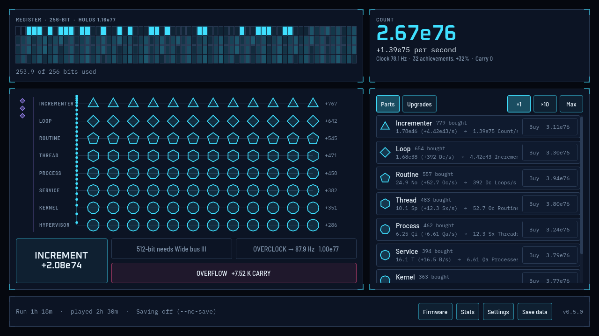

# Incrementer

An incremental game about a counter inside a forgotten machine. Write software that counts faster, widen the register so the number fits, and overflow to start again stronger.

Built with **Godot 4.7.2** (GDScript, Compatibility renderer) for the Web and Windows.



## Status

**Version 1.0.2.** The whole V1 game is done, from the first click to the ending at a full 1024-bit register (about six hours): eight Software layers, register widths from 8 to 1024 bits, 40 upgrades, 34 achievements, Overclock, the Overflow, Carry, 23 Firmware nodes with autobuyers, settings, save export and import, and offline progress. See [CHANGELOG.md](CHANGELOG.md) and the [progress log](docs/PROGRESS.md).

## Playing it

Download a build from the [releases page](https://github.com/MrM1y4g1/Incrementer/releases):

- **Windows:** unzip `Incrementer-1.0.2-windows.zip` and run `Incrementer.exe`. Windows may show a SmartScreen warning because the game isn't code-signed: choose **More info → Run anyway**. Saves live in `%APPDATA%\Godot\app_userdata\Incrementer`.
- **Web:** `Incrementer-1.0.2-web.zip` is ready for itch.io. To play it locally, serve the unzipped folder with any static web server and open `index.html`; it needs a browser with WebGL 2. Browser saves can be lost with site data, so use **Save data → Copy** to keep a backup.

Click the register or press **Space** to increment. The `windows-debug` build adds a debug panel on **F3**.

## Running it from source

Godot isn't checked in. Put a self-contained copy in `.tools/godot/` as described in [AGENTS.md](AGENTS.md), then:

```sh
.tools/godot/Godot_v4.7.2-stable_win64_console.exe --path .                       # play
.tools/godot/Godot_v4.7.2-stable_win64_console.exe --headless --path . --import   # first run after cloning
.tools/godot/Godot_v4.7.2-stable_win64_console.exe --headless --path . --script res://tests/run_tests.gd -- --no-save
```

Contributors and coding agents: start with [AGENTS.md](AGENTS.md).

## Credits

- Fonts: [Barlow Semi Condensed](https://fonts.google.com/specimen/Barlow+Semi+Condensed), [IBM Plex Mono](https://fonts.google.com/specimen/IBM+Plex+Mono) and [Oxanium](https://fonts.google.com/specimen/Oxanium), all under the SIL Open Font License (licences in `assets/fonts/`).
- Sound and music are synthesised by `tools/make_sounds.gd`.
- Built with [Godot Engine](https://godotengine.org).
