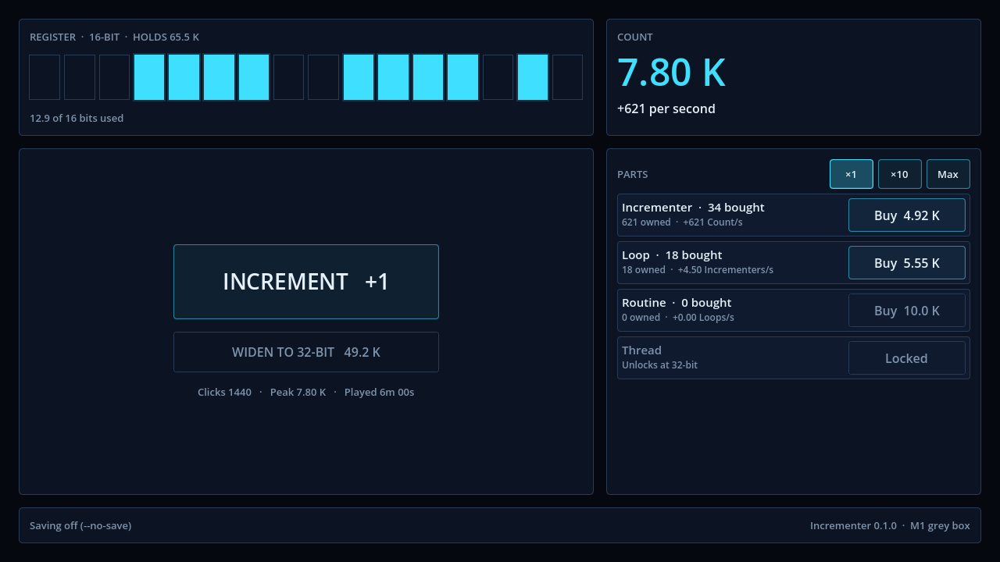

# Incrementer

An incremental game about a counter inside a forgotten machine. Write software that counts faster, widen the register so the number fits, and overflow to start again stronger.

Built with **Godot 4.7.2** (GDScript, Compatibility renderer) for the Web and Windows.



## Status

Milestones **M1 (core loop)**, **M2 (progression)** and **M3 (Overflow and Firmware)** are in. The game is playable from the first click to the V1 ending: eight Software layers, register widths from 8 to 1024 bits, 40 upgrades, 34 achievements, Overclock, the Overflow, Carry, 23 Firmware nodes with autobuyers, save export and import, and offline progress. The late-game pacing is still being balanced (M4).

## Running it

Godot isn't checked in. Put a self-contained copy in `.tools/godot/` as described in [AGENTS.md](AGENTS.md), then:

```sh
.tools/godot/Godot_v4.7.2-stable_win64_console.exe --path .                       # play
.tools/godot/Godot_v4.7.2-stable_win64_console.exe --headless --path . --import   # first run after cloning
.tools/godot/Godot_v4.7.2-stable_win64_console.exe --headless --path . --script res://tests/run_tests.gd -- --no-save
```

Contributors and coding agents: start with [AGENTS.md](AGENTS.md).
