# Progress log

Newest first. Screenshots are captured from the real game at 1280 × 720. The `--autoplay` flag fast-forwards a scripted player, so the later shots show a run in progress.

## 18 Oct 2026 · M4: balance pass

**What changed**

- **Carry bonus:** Count per second × (1 + Carry earned)^12.5. Carry grows exponentially with the bits a run reaches, so this power law adds a fixed number of bits per doubling of Carry. That fits the register ladder, where every width is double the one before.
- **One run per width.** Each Wide bus costs about what one full run at the previous width pays: 1, 32, 8,000 and 500 million Carry. Each Overflow now opens the next width instead of needing near-instant repeats at the same one.
- **Gentler milestone Firmware** (Pipelining, Superscalar and Speculative execution now give the ×2 every 36, 32 and 28 units). At 20 units, the "more Count, more units, more doublings" loop nearly fed itself without limit, so late runs exploded while the 256-bit run crawled.
- **Pacing checks in CI.** The simulator also measures the longest wait for a purchase in the first hour, and `--check` fails the build when pacing leaves the plan's windows. CI now runs the whole game to the ending on every push.

**Simulated pacing** (scripted player, 4 clicks per second):

| Measure | Simulated | Plan target |
|---|---|---|
| Longest wait for a purchase in the first hour | 52 s | ≤ 90 s |
| First Overflow (64-bit full) | 49:27 | 40–60 min |
| Second Overflow (128-bit full) | 1:11 | – |
| Third Overflow (256-bit full) | 2:38 | – |
| Fourth Overflow (512-bit full) | 5:52 | – |
| V1 ending (1024-bit full) | 5:52 | 5–8 h (6:30) |

**Known rough edges.** The 512-bit run takes about 3 hours, the longest of the game, but offline progress (24 hours with the Watchdog Firmware) covers most of it. The final 1024-bit run is nearly instant: it plays as a victory lap. Real players will choose different moments to Overflow, so these numbers need a human playtest.

**256-bit run,** 2½ hours in.

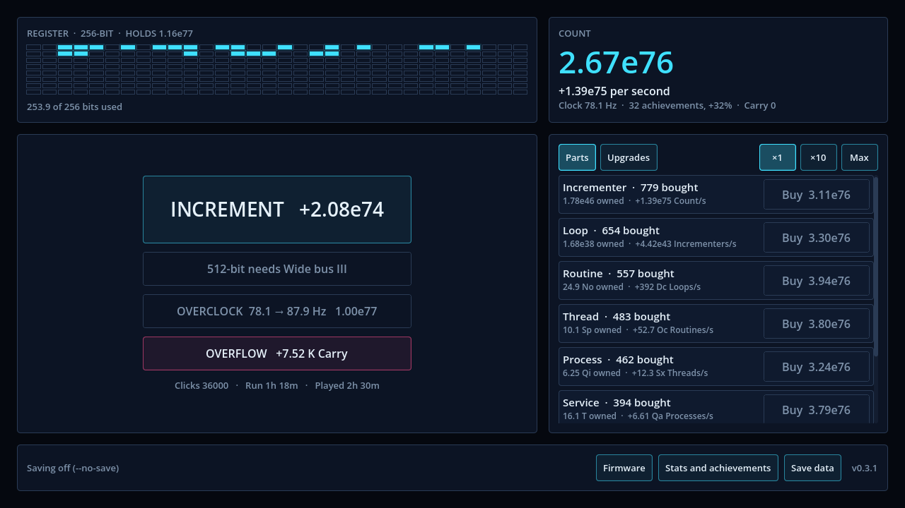

**512-bit run,** 4½ hours in: almost full, with 604 million Carry waiting.

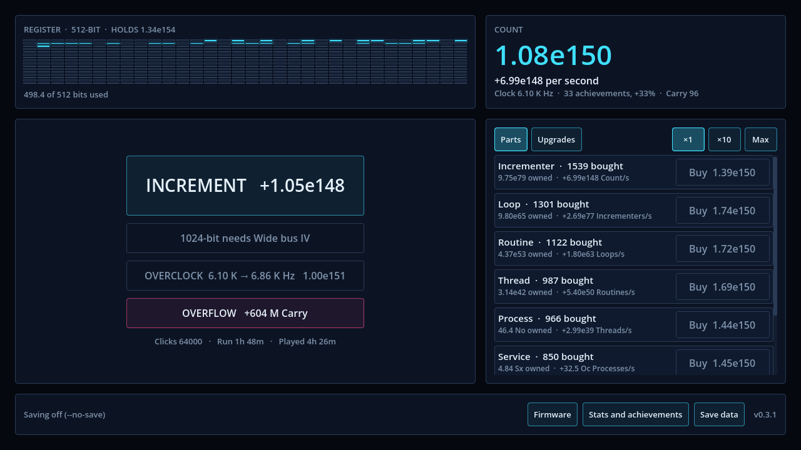

**Next (M5):** the real look. Clean-lined sci-fi art from plan section 4: the register matrix, polygon tier shapes, the fonts, motion and sound. The register display needs a new layout for 256 bits and up, where the cells are too small.

## 18 Oct 2026 · M3: Overflow, Carry, Firmware and the V1 ending

**What's in**

- **Overflow.** Once a run has filled a 64-bit register, an Overflow button appears (in magenta, the Overflow colour). It asks for confirmation, then resets the Count, layers, register, clock and this run's upgrades and pays **Carry**: 2 for a full 64-bit register, doubling for every 16 bits beyond it. Carry earned also boosts Count per second, by ×(1 + Carry earned)^10, so every run starts faster than the last.
- **Firmware:** 23 permanent nodes in five columns, bought with Carry. They include **Wide bus I–IV**, which unlock 128, 256, 512 and 1024-bit registers (Hypervisors arrive at 128); **Boot ROMs** that start runs on a wider register; Count multipliers; Carry multipliers; a 24-hour offline cap; three nodes that bring the ×2 milestones sooner; and **autobuyers** for layers, Overclock and widening, each with an on/off switch.
- **The V1 ending.** Filling a 1024-bit register (1.80e308, the largest 64-bit float) shows the ending screen with the run history. The save stays playable.
- **Save data:** export the whole game as text and import it again, a backup for browser players. The save format is now version 3; M1 and M2 saves still load.
- Wider registers draw as a grid of 32 columns. 71 tests, and the simulator now plays all the way to the ending.

**Overflow confirmation,** early in the second run.

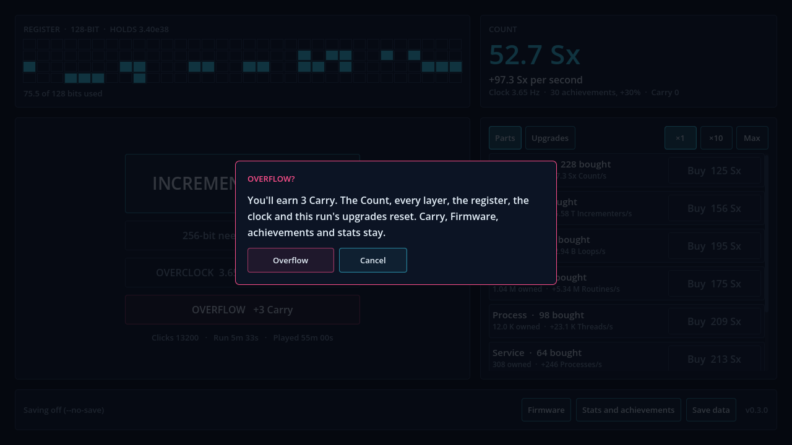

**A 128-bit register,** about an hour and ten minutes in.

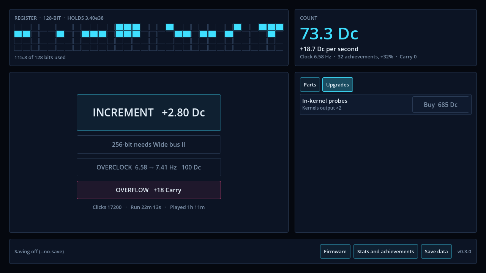

**Firmware.**

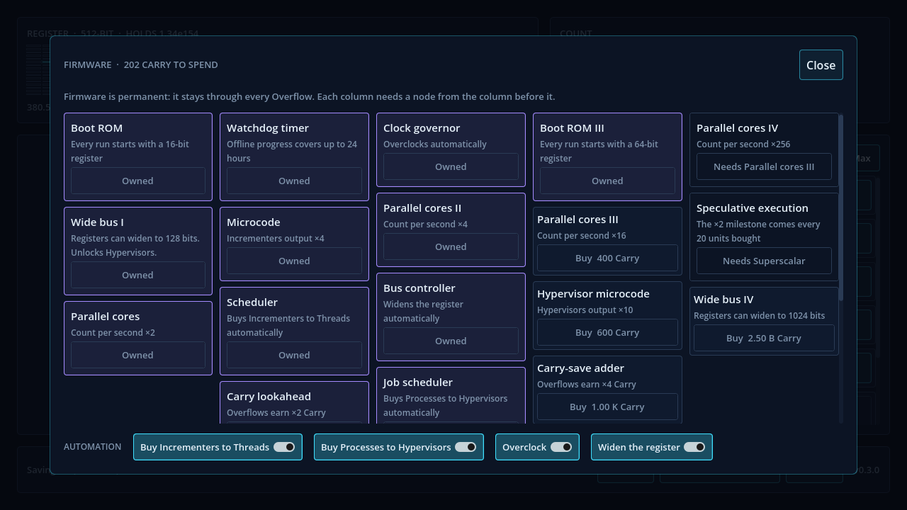

**The V1 ending** and run history, from a simulated playthrough.

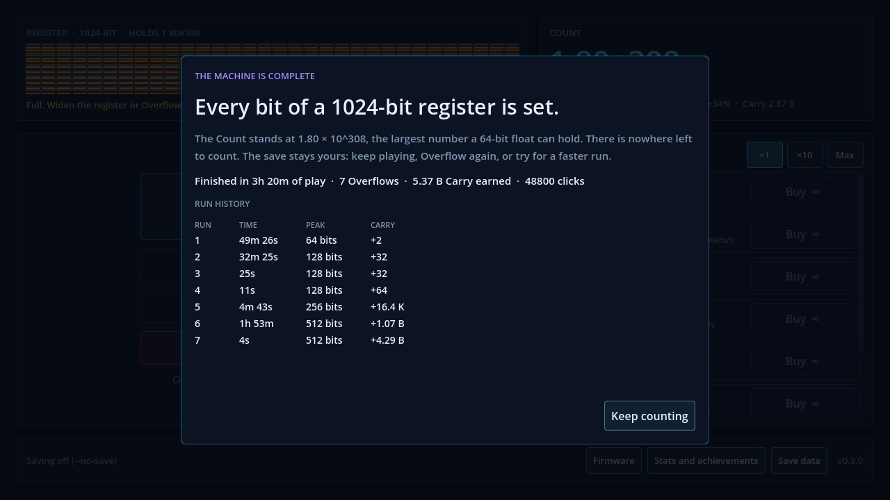

**Save data:** export and import.

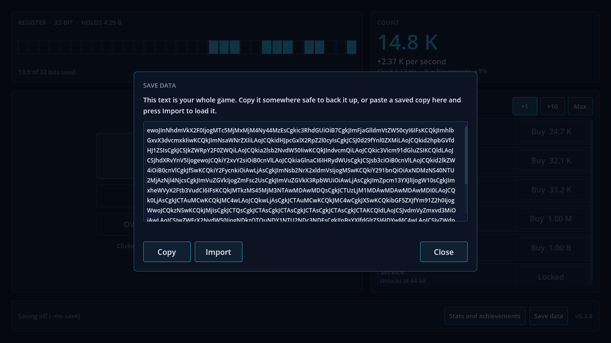

**Simulated journey.** First Overflow at 49 min, 128-bit at 52 min, 256-bit at 1h 22m, 512-bit at 1h 27m, ending at **3h 20m** (plan: 6h 30m). Runs at the same width are too uneven: some take seconds, one takes nearly two hours. The milestone that most needs more time is the 256-bit stretch.

**Next (M4):** the balance pass. Smooth the late game so each run takes a steady 30–60 minutes and the ending lands near 6½ hours, make the autoplayer's Overflow timing more human, and get playtest feedback.

## 18 Oct 2026 · M2: upgrades, achievements, clock, stats and debug tools

**What's in**

- **40 upgrades** as data files in `data/upgrades/`: four ×2 upgrades per layer (after 10, 25, 50 and 100 bought), two click upgrades, two that make clicks add a share of Count per second, and four Count-per-second boosts. They appear in a new **Upgrades** tab, cheapest first, as soon as their requirements are met. Ones the register can't hold yet say which width they need.
- **30 achievements** in `data/achievements/`, each worth +1% Count per second, with a pop-up when one unlocks.
- **Overclock:** each level raises the clock by ×1.125 and costs 100× the last.
- **Stats screen** with run numbers and every achievement.
- **Debug panel** (debug builds only, F3): fill the register, add an hour of production, run at ×10 or ×100 speed, set the register width, wipe the save.
- Content is checked at startup: duplicate or missing ids, or upgrades pointing at layers that don't exist, stop a debug build with a clear message.
- Save format version 2, with a migration that loads version 1 saves. 53 tests.

**Upgrades tab, 10 minutes in.**

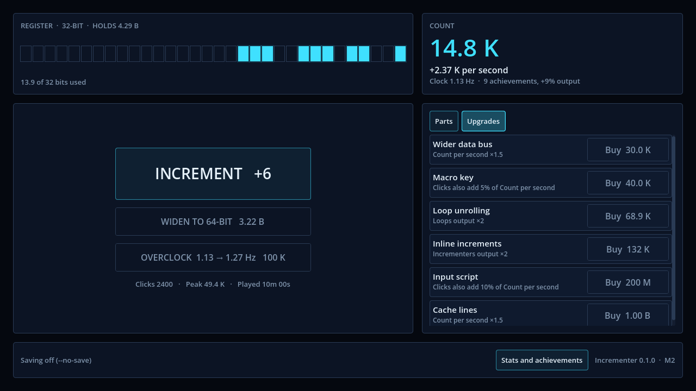

**25 minutes in,** with an achievement pop-up.

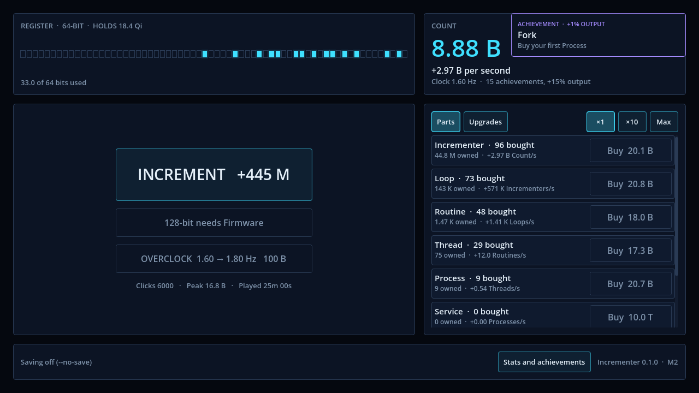

**Stats and achievements, 45 minutes in.**

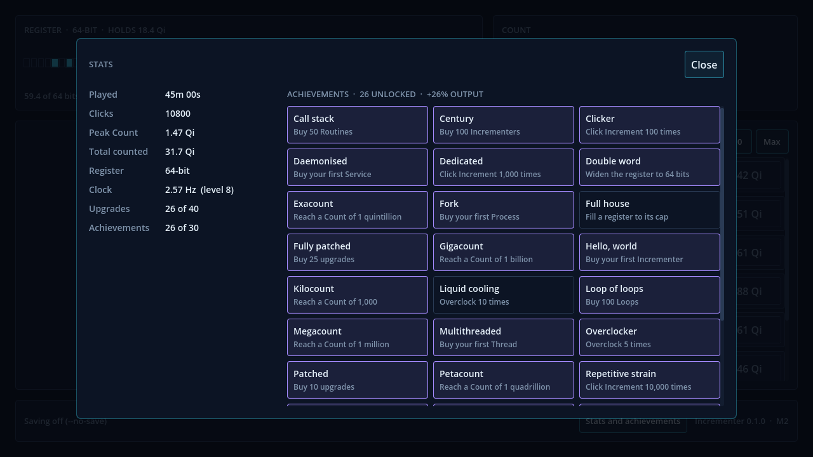

**Debug panel** (F3 in debug builds).

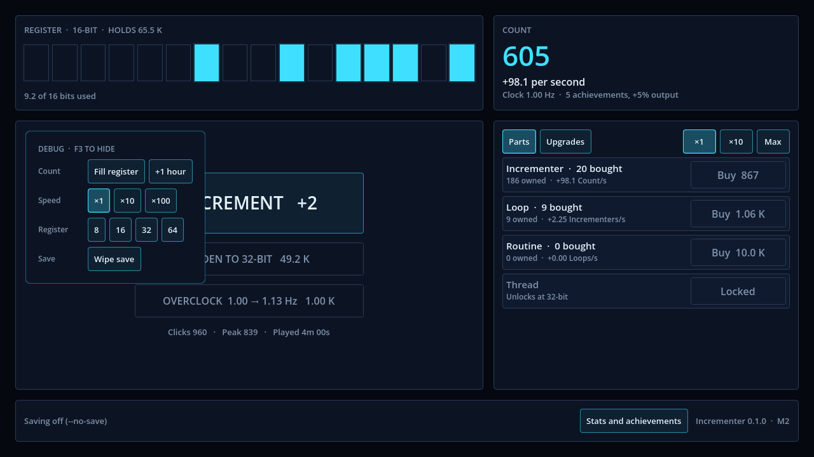

**A balance finding.** Software layers produce each other in a chain, so a boost applied to every layer compounds down the chain: "×2 to everything" was really about ×2 to the power of the number of active layers. With upgrades and the clock added, the simulator filled a 64-bit register in 7 minutes. Global boosts (the clock, achievements and the Count-per-second upgrades) now multiply the Count per second only, so ×2 means ×2. Upgrades for a single layer still multiply that layer. The ×2 milestone bonus now comes every **40** units bought.

| Milestone | Simulated | Plan target |
|---|---|---|
| 16-bit | 0:44 | 1:00 |
| 32-bit | 7:23 | 6:00 |
| 64-bit | 21:32 | 20:00 |
| 64-bit full (first Overflow) | 49:27 | 50:00 (40–60) |

**Next (M3):** the Overflow itself, Carry bits, the Firmware tree, registers up to 1024 bits, the Hypervisor layer, autobuyers and the V1 ending.

## 18 Oct 2026 · M0 and M1: project set up, core loop playable

**What's in**

- Godot 4.7.2 project with the Compatibility renderer, strict static typing, and the folder layout from the plan.
- The core loop: the Increment button, eight Software layers that each produce the layer below, buying in ×1, ×10 or Max, and register widths 8 → 16 → 32 → 64 bits with the hard cap and the Widen button. 128-bit waits for Firmware (M3).
- The register display shows the Count in binary, one cell per bit, and turns amber when full.
- Saves: JSON in `user://`, autosave every 30 seconds and on quit or focus loss, a backup file, a version number for future migrations, and offline progress for up to 8 hours with a "While you were away" report.
- 37 automated tests (formulas, number formatting, economy, saves, content) and a GitHub Actions workflow that runs them.
- `tools/sim.gd`, the first balance simulator, plus `--autoplay` and `--capture` flags for screenshots.

**Fresh start.** Eight empty register cells, two layers to buy, the rest revealed as the register grows.

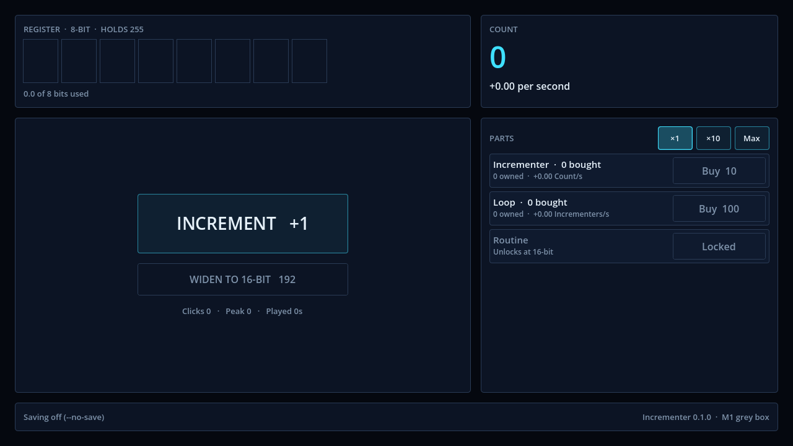

**Six minutes in.** A 16-bit register showing 7.80 K in binary; Routines just unlocked.

**25 minutes in.** A 64-bit register and five layers running.

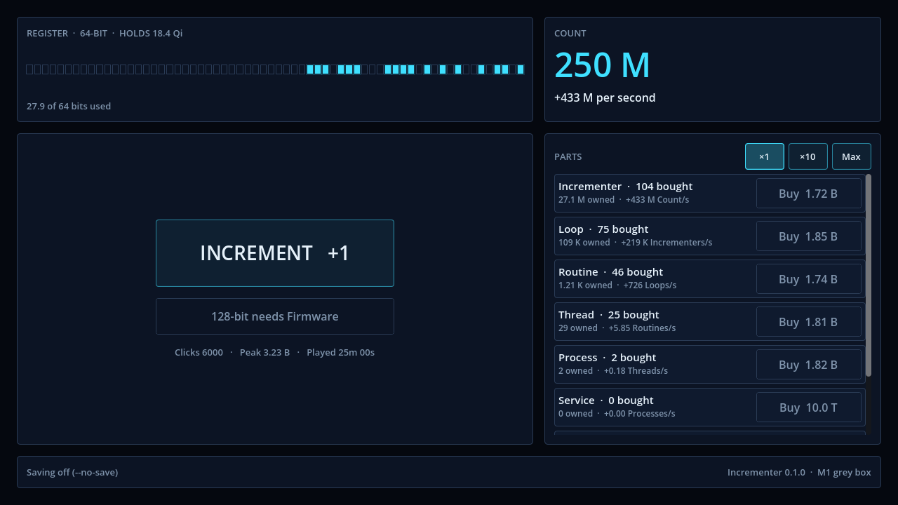

**One hour in.** The 64-bit register is full, every cell lit in amber. This is where the first Overflow will go in M3.

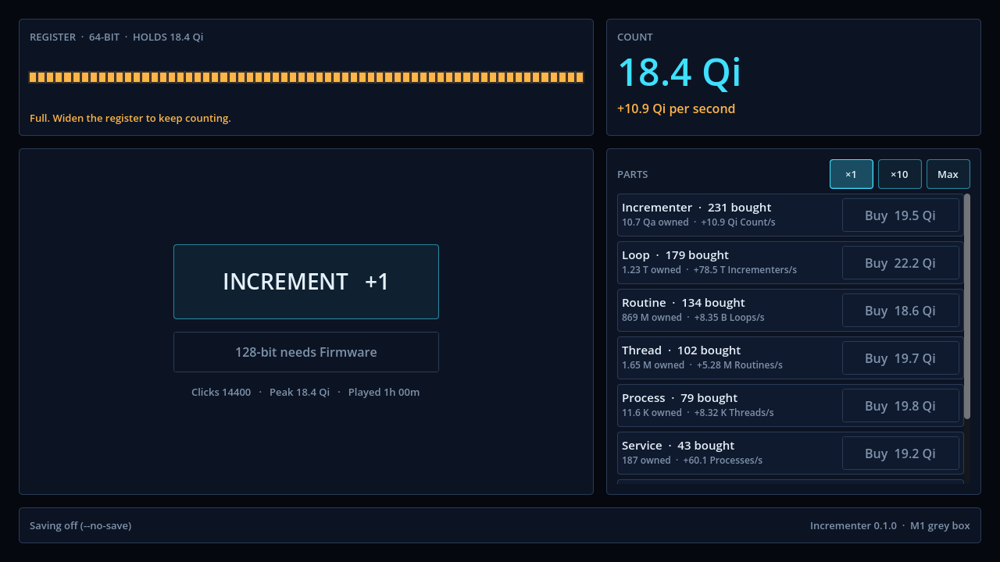

**Balance changes from the plan's starting values.** The plan's first numbers (×2 output every 10 bought, price growth 1.12–1.20) let the simulator fill a 64-bit register in 2 minutes 19 seconds. The current values double output every **20** bought and raise prices by **1.20–1.45** per unit. Simulated pacing now:

| Milestone | Simulated | Plan target |
|---|---|---|
| 16-bit | 0:44 | 1:00 |
| 32-bit | 6:56 | 6:00 |
| 64-bit | 23:15 | 20:00 |
| 64-bit full (first Overflow) | 58:09 | 50:00 (40–60) |

**Next (M2):** upgrades and achievements as data files, Clock upgrades, a stats screen, and a debug panel. Web and Windows export presets are in place; building them needs Godot's export templates, which aren't downloaded yet.
